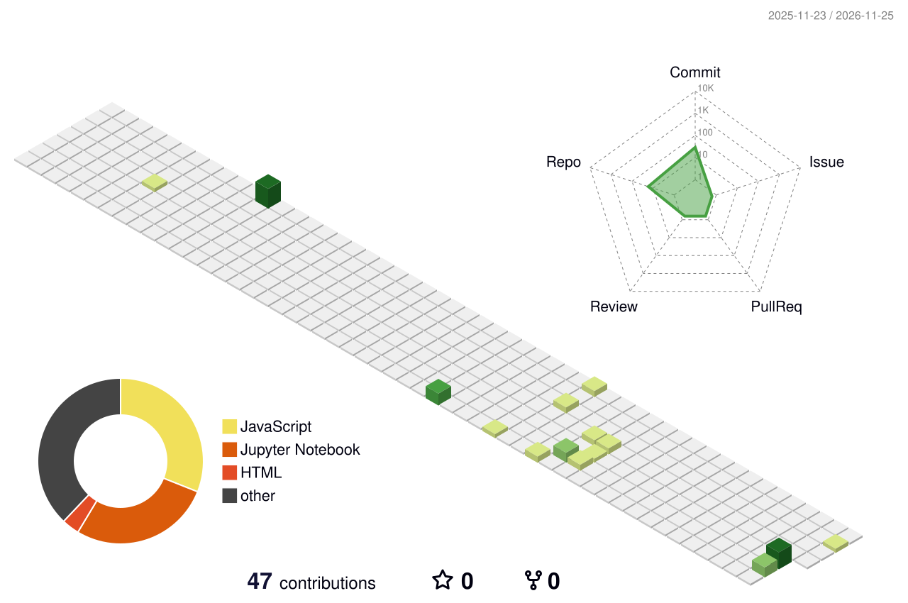

# Udaya Raghavendra

[3D portfolio](https://udayparimi.github.io/Udayparimi/) · [Featured projects](#featured-projects) · [Contact](#contact)

## About me

I’m Uday, a first-year MCA student at **CHRIST (Deemed to be University), Bengaluru**. I earned a **BCA in Data Science** at Acharya Institute of Graduate Studies, Bengaluru (2023–2026). I’m pursuing a career in **data analytics** and also build full-stack applications with MongoDB, Express, React, and Node.js.

**Currently working on** state-wise UPI adoption analysis in India using NPCI data for my MCA research.  
**Currently learning** applied data analytics and machine learning.

## Featured projects

| Project | What it does | Stack | Repo / Demo |
| --- | --- | --- | --- |
| **Hotel Payment Tracker** | Track hotel payments and registrations in an app that evolved from HTML and JavaScript to MERN. | HTML · JavaScript · MERN | [Repo](https://github.com/Udayparimi/FSD-Lab5-and-6) |
| **Campus Event Management System** | Students discover and register for events while admins manage the event lifecycle. | React · Express · Node.js · MongoDB | [Repo](https://github.com/Udayparimi/Campus-event-management) |
| **Student Project Tracker** | Create, update, and organize student projects by status. | React · Express · Node.js · MongoDB | [Repo](https://github.com/Udayparimi/FSD-CIA-3) |
| **Registration Form with CRUD** | Create, view, update, and delete registration records. | React · Express · Node.js · MongoDB | — |
| **State-wise UPI Adoption in India** | MCA research project examining differences in UPI adoption across Indian states using NPCI data. | Data analytics · NPCI data | — |
| **Graph Algorithms in C** | Implement topological sorting and minimum spanning trees with Prim’s and Kruskal’s algorithms. | C · Data structures · Graph algorithms | — |

[Sales forecasting notebook](https://github.com/Udayparimi/sales-forecasting-arima-prophet-lstm) · [Customer churn notebook](https://github.com/Udayparimi/customer-churn-prediction) · [All repositories](https://github.com/Udayparimi?tab=repositories)

## Tech stack

| | |
| --- | --- |
| **Languages** |    |
| **Web** |    |
| **Data and databases** |      |
| **Tools** |  |

## GitHub activity

<picture>
  <source media="(prefers-color-scheme: dark)" srcset="https://github-readme-stats.vercel.app/api?username=Udayparimi&amp;hide_border=true&amp;show_icons=true&amp;theme=github_dark">
  <source media="(prefers-color-scheme: light)" srcset="https://github-readme-stats.vercel.app/api?username=Udayparimi&amp;hide_border=true&amp;show_icons=true&amp;theme=default">
  
</picture>

<picture>
  <source media="(prefers-color-scheme: dark)" srcset="https://github-readme-stats.vercel.app/api/top-langs/?username=Udayparimi&amp;layout=compact&amp;hide_border=true&amp;theme=github_dark">
  <source media="(prefers-color-scheme: light)" srcset="https://github-readme-stats.vercel.app/api/top-langs/?username=Udayparimi&amp;layout=compact&amp;hide_border=true&amp;theme=default">
  
</picture>

<picture>
  <source media="(prefers-color-scheme: dark)" srcset="https://streak-stats.demolab.com/?user=Udayparimi&amp;theme=github-dark-blue&amp;hide_border=true">
  <source media="(prefers-color-scheme: light)" srcset="https://streak-stats.demolab.com/?user=Udayparimi&amp;theme=default&amp;hide_border=true">
  
</picture>

[View GitHub activity and repositories](https://github.com/Udayparimi)

Contribution snake and 3D calendar

<picture>
  <source media="(prefers-color-scheme: dark)" srcset="https://raw.githubusercontent.com/Udayparimi/Udayparimi/output/snake-dark.svg">
  <source media="(prefers-color-scheme: light)" srcset="https://raw.githubusercontent.com/Udayparimi/Udayparimi/output/snake-light.svg">
  
</picture>

<picture>
  <source media="(prefers-color-scheme: dark)" srcset="https://raw.githubusercontent.com/Udayparimi/Udayparimi/output/calendar-dark.svg">
  <source media="(prefers-color-scheme: light)" srcset="https://raw.githubusercontent.com/Udayparimi/Udayparimi/output/calendar-light.svg">
  
</picture>

## Contact

