<a href="https://udayparimi.github.io/Udayparimi/project-explorer.html#display" title="Try the interactive flip-dot display"><picture><source media="(max-width: 600px) and (prefers-reduced-motion: reduce)" srcset="docs/flipdot/display-mobile-still.svg"><source media="(prefers-reduced-motion: reduce)" srcset="docs/flipdot/display-still.svg"><source media="(max-width: 600px)" srcset="docs/flipdot/display-mobile.svg"></picture></a>

<picture><source media="(max-width: 600px) and (prefers-reduced-motion: reduce)" srcset="docs/folio/about-mobile-still.svg"><source media="(prefers-reduced-motion: reduce)" srcset="docs/folio/about-still.svg"><source media="(max-width: 600px)" srcset="docs/folio/about-mobile.svg"></picture>

<p><a href="#jump-data-analysis">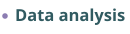</a> <a href="#jump-web-applications"></a> <a href="#jump-build-archive">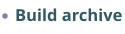</a> <a href="#jump-skills"></a> <a href="#jump-contact">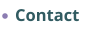</a></p>

<a name="jump-data-analysis"></a>

## <picture><source media="(prefers-color-scheme: dark)" srcset="docs/flipdot/data-analysis-dark.svg"></picture>

<a href="https://udayparimi.github.io/Udayparimi/project-explorer.html#inspect-forecast" title="Inspect Sales Forecasting in 3D"><picture><source media="(max-width: 600px) and (prefers-reduced-motion: reduce)" srcset="docs/folio/forecast-mobile-still.svg"><source media="(prefers-reduced-motion: reduce)" srcset="docs/folio/forecast-still.svg"><source media="(max-width: 600px)" srcset="docs/folio/forecast-mobile.svg"></picture></a>

<details>
<summary><strong>Inside Sales Forecasting</strong></summary>

On daily grocery sales, Prophet returned a mean absolute error of 74k. SARIMAX and LSTM each returned 99k.

**90-day holdout**

```text
Prophet · MAE 74k · RMSE 100k
```

SARIMAX · Prophet · LSTM  
[Repository ↗](https://github.com/Udayparimi/sales-forecasting-arima-prophet-lstm) · [Inspect in 3D ↗](https://udayparimi.github.io/Udayparimi/project-explorer.html#inspect-forecast)

</details>

<a href="https://udayparimi.github.io/Udayparimi/project-explorer.html#inspect-churn" title="Inspect Customer Churn Prediction in 3D"><picture><source media="(max-width: 600px) and (prefers-reduced-motion: reduce)" srcset="docs/folio/churn-mobile-still.svg"><source media="(prefers-reduced-motion: reduce)" srcset="docs/folio/churn-still.svg"><source media="(max-width: 600px)" srcset="docs/folio/churn-mobile.svg"></picture></a>

<details>
<summary><strong>Inside Customer Churn Prediction</strong></summary>

The notebook compares logistic regression, random forest, and XGBoost and examines contract type, tenure, and monthly charges.

**Telco customer features**

```text
Contract type · tenure · monthly charges
```

Python · logistic regression · random forest · XGBoost  
[Repository ↗](https://github.com/Udayparimi/customer-churn-prediction) · [Inspect in 3D ↗](https://udayparimi.github.io/Udayparimi/project-explorer.html#inspect-churn)

</details>

<a name="jump-web-applications"></a>

## <picture><source media="(prefers-color-scheme: dark)" srcset="docs/flipdot/web-applications-dark.svg"></picture>

<p>
<a href="https://udayparimi.github.io/Udayparimi/project-explorer.html#inspect-hotel" title="Inspect Hotel Payment Tracker in 3D"><picture><source media="(prefers-reduced-motion: reduce)" srcset="docs/folio/hotel-still.svg"></picture></a>
<a href="https://udayparimi.github.io/Udayparimi/project-explorer.html#inspect-campus" title="Inspect Campus Event Management in 3D"><picture><source media="(prefers-reduced-motion: reduce)" srcset="docs/folio/campus-still.svg"></picture></a>
</p>

<details>
<summary><strong>Inside Hotel Payment Tracker</strong></summary>

Reports fetch payment data on the server. The payments page hands the initial list to a client component for search, filtering, and edits.

**Client handoff**

```text
PaymentsClient.jsx
```

Next.js · React · Express · MongoDB  
[Repository ↗](https://github.com/Udayparimi/FSD-Lab9-10) · [Inspect in 3D ↗](https://udayparimi.github.io/Udayparimi/project-explorer.html#inspect-hotel)

</details>

<details>
<summary><strong>Inside Campus Event Management</strong></summary>

Students register for events while admins manage the event lifecycle through role-protected routes.

**Student permission**

```text
student → register for event
```

MERN · JWT · React Router  
[Repository ↗](https://github.com/Udayparimi/Campus-event-management) · [Inspect in 3D ↗](https://udayparimi.github.io/Udayparimi/project-explorer.html#inspect-campus)

</details>

<p>
<a href="https://udayparimi.github.io/Udayparimi/project-explorer.html#inspect-student" title="Inspect Student Project Tracker in 3D"><picture><source media="(prefers-reduced-motion: reduce)" srcset="docs/folio/student-still.svg"></picture></a>
<a href="https://udayparimi.github.io/Udayparimi/project-explorer.html#inspect-dashboard" title="Inspect Payment Tracking Dashboard in 3D"><picture><source media="(prefers-reduced-motion: reduce)" srcset="docs/folio/dashboard-still.svg"></picture></a>
</p>

<details>
<summary><strong>Inside Student Project Tracker</strong></summary>

The React form adds projects. Changing a status sends a PUT request with projectStatus and fetches the refreshed list.

**Status update**

```text
PUT /projects/:id
{ "projectStatus": "ongoing" }
```

React · Express · MongoDB  
[Repository ↗](https://github.com/Udayparimi/FSD-CIA-3) · [Inspect in 3D ↗](https://udayparimi.github.io/Udayparimi/project-explorer.html#inspect-student)

</details>

<details>
<summary><strong>Inside Payment Tracking Dashboard</strong></summary>

The dashboard searches and filters payment records, calculates revenue statistics, and persists changes in browser storage.

**Method filter**

```text
payment.method === selected
```

JavaScript · Local Storage API  
[Repository ↗](https://github.com/Udayparimi/Payment-Tracking-dashboard) · [Inspect in 3D ↗](https://udayparimi.github.io/Udayparimi/project-explorer.html#inspect-dashboard)

</details>

<a name="jump-build-archive"></a>

## <picture><source media="(prefers-color-scheme: dark)" srcset="docs/flipdot/build-archive-dark.svg"></picture>

### 

<a href="https://udayparimi.github.io/Udayparimi/project-explorer.html#inspect-hotel-static" title="Inspect Responsive Hotel Pages in 3D"><picture><source media="(max-width: 600px) and (prefers-reduced-motion: reduce)" srcset="docs/folio/hotel-static-mobile-still.svg"><source media="(prefers-reduced-motion: reduce)" srcset="docs/folio/hotel-static-still.svg"><source media="(max-width: 600px)" srcset="docs/folio/hotel-static-mobile.svg"></picture></a>

<details>
<summary><strong>Inside Responsive Hotel Pages</strong></summary>

Responsive pages cover payments, reports, analytics, and hotel navigation.

**Responsive layout**

```text
Wide viewport → narrow viewport
```

HTML · CSS  
[Repository ↗](https://github.com/Udayparimi/hotel-payment-tracking-system) · [Inspect in 3D ↗](https://udayparimi.github.io/Udayparimi/project-explorer.html#inspect-hotel-static)

</details>

<a href="https://udayparimi.github.io/Udayparimi/project-explorer.html#inspect-hotel-local" title="Inspect Browser Payment Storage in 3D"><picture><source media="(max-width: 600px) and (prefers-reduced-motion: reduce)" srcset="docs/folio/hotel-local-mobile-still.svg"><source media="(prefers-reduced-motion: reduce)" srcset="docs/folio/hotel-local-still.svg"><source media="(max-width: 600px)" srcset="docs/folio/hotel-local-mobile.svg"></picture></a>

<details>
<summary><strong>Inside Browser Payment Storage</strong></summary>

A payment modal adds records and the browser keeps them under the payments key.

**Browser write**

```text
localStorage.setItem("payments", …)
```

JavaScript · Local Storage API  
[Repository ↗](https://github.com/Udayparimi/Hotel-Payment-Tracker-Lab2) · [Inspect in 3D ↗](https://udayparimi.github.io/Udayparimi/project-explorer.html#inspect-hotel-local)

</details>

<a href="https://udayparimi.github.io/Udayparimi/project-explorer.html#inspect-hotel-register" title="Inspect Guest Registration in 3D"><picture><source media="(max-width: 600px) and (prefers-reduced-motion: reduce)" srcset="docs/folio/hotel-register-mobile-still.svg"><source media="(prefers-reduced-motion: reduce)" srcset="docs/folio/hotel-register-still.svg"><source media="(max-width: 600px)" srcset="docs/folio/hotel-register-mobile.svg"></picture></a>

<details>
<summary><strong>Inside Guest Registration</strong></summary>

The registration module validates input, generates a customer ID and temporary PIN, and stores the customer locally.

**After validation**

```text
Customer ID + temporary PIN
```

JavaScript · form validation · localStorage  
[Repository ↗](https://github.com/Udayparimi/Hotel-Payment-Tracker-Lab3) · [Inspect in 3D ↗](https://udayparimi.github.io/Udayparimi/project-explorer.html#inspect-hotel-register)

</details>

<a href="https://udayparimi.github.io/Udayparimi/project-explorer.html#inspect-hotel-crud" title="Inspect Payment CRUD in 3D"><picture><source media="(max-width: 600px) and (prefers-reduced-motion: reduce)" srcset="docs/folio/hotel-crud-mobile-still.svg"><source media="(prefers-reduced-motion: reduce)" srcset="docs/folio/hotel-crud-still.svg"><source media="(max-width: 600px)" srcset="docs/folio/hotel-crud-mobile.svg"></picture></a>

<details>
<summary><strong>Inside Payment CRUD</strong></summary>

Updates to stored payment objects change the paid and pending categories in the reports.

**Record change**

```text
status: "Pending" → "Paid"
```

JavaScript · CRUD · localStorage  
[Repository ↗](https://github.com/Udayparimi/Hotel-Payment-Tracker-Lab4) · [Inspect in 3D ↗](https://udayparimi.github.io/Udayparimi/project-explorer.html#inspect-hotel-crud)

</details>

### 

<a href="https://udayparimi.github.io/Udayparimi/project-explorer.html#inspect-hotel-api" title="Inspect Hotel Payments REST API in 3D"><picture><source media="(max-width: 600px) and (prefers-reduced-motion: reduce)" srcset="docs/folio/hotel-api-mobile-still.svg"><source media="(prefers-reduced-motion: reduce)" srcset="docs/folio/hotel-api-still.svg"><source media="(max-width: 600px)" srcset="docs/folio/hotel-api-mobile.svg"></picture></a>

<details>
<summary><strong>Inside Hotel Payments REST API</strong></summary>

The Express API exposes CRUD endpoints for payments and registrations. The diagram follows GET /api/payments/:id.

**HTTP request**

```text
GET /api/payments/:id
```

Node.js · Express · Mongoose · MongoDB  
[Repository ↗](https://github.com/Udayparimi/FSD-Lab4) · [Inspect in 3D ↗](https://udayparimi.github.io/Udayparimi/project-explorer.html#inspect-hotel-api)

</details>

<a href="https://udayparimi.github.io/Udayparimi/project-explorer.html#inspect-hotel-mern" title="Inspect HotelPay MERN Build in 3D"><picture><source media="(max-width: 600px) and (prefers-reduced-motion: reduce)" srcset="docs/folio/hotel-mern-mobile-still.svg"><source media="(prefers-reduced-motion: reduce)" srcset="docs/folio/hotel-mern-still.svg"><source media="(max-width: 600px)" srcset="docs/folio/hotel-mern-mobile.svg"></picture></a>

<details>
<summary><strong>Inside HotelPay MERN Build</strong></summary>

HotelPay runs a React frontend and an Express backend with a configurable MongoDB connection.

**Request path**

```text
React → Express → MongoDB
```

React · Vite · Express · MongoDB  
[Repository ↗](https://github.com/Udayparimi/FSD-Lab5-and-6) · [Inspect in 3D ↗](https://udayparimi.github.io/Udayparimi/project-explorer.html#inspect-hotel-mern)

</details>

<a href="https://udayparimi.github.io/Udayparimi/project-explorer.html#inspect-hotel-reactlab" title="Inspect React Hotel Tracker in 3D"><picture><source media="(max-width: 600px) and (prefers-reduced-motion: reduce)" srcset="docs/folio/hotel-reactlab-mobile-still.svg"><source media="(prefers-reduced-motion: reduce)" srcset="docs/folio/hotel-reactlab-still.svg"><source media="(max-width: 600px)" srcset="docs/folio/hotel-reactlab-mobile.svg"></picture></a>

<details>
<summary><strong>Inside React Hotel Tracker</strong></summary>

App.jsx switches between Registration, Payments, and ActivityLog based on local page state.

**Active component**

```text
setPage("payments") → <Payments />
```

React · useState · JSX  
[Repository ↗](https://github.com/Udayparimi/hotel-payment-tracker-Lab7) · [Inspect in 3D ↗](https://udayparimi.github.io/Udayparimi/project-explorer.html#inspect-hotel-reactlab)

</details>

<a href="https://udayparimi.github.io/Udayparimi/project-explorer.html#inspect-hotel-mail" title="Inspect Payment Receipt Email in 3D"><picture><source media="(max-width: 600px) and (prefers-reduced-motion: reduce)" srcset="docs/folio/hotel-mail-mobile-still.svg"><source media="(prefers-reduced-motion: reduce)" srcset="docs/folio/hotel-mail-still.svg"><source media="(max-width: 600px)" srcset="docs/folio/hotel-mail-mobile.svg"></picture></a>

<details>
<summary><strong>Inside Payment Receipt Email</strong></summary>

When SMTP is configured, the backend can send a receipt for a paid payment. The API also runs without mail configuration.

**Delivery condition**

```text
Paid payment + configured SMTP → receipt
```

Express · MongoDB · Nodemailer  
[Repository ↗](https://github.com/Udayparimi/FSD-Lab8) · [Inspect in 3D ↗](https://udayparimi.github.io/Udayparimi/project-explorer.html#inspect-hotel-mail)

</details>

### 

<a href="https://udayparimi.github.io/Udayparimi/project-explorer.html#inspect-hotel-router" title="Inspect React Router Hotel Pages in 3D"><picture><source media="(max-width: 600px) and (prefers-reduced-motion: reduce)" srcset="docs/folio/hotel-router-mobile-still.svg"><source media="(prefers-reduced-motion: reduce)" srcset="docs/folio/hotel-router-still.svg"><source media="(max-width: 600px)" srcset="docs/folio/hotel-router-mobile.svg"></picture></a>

<details>
<summary><strong>Inside React Router Hotel Pages</strong></summary>

React Router replaces separate HTML pages with client-side routes while API calls are centralized in src/api.js.

**Route match**

```text
/analytics → Analytics.jsx
```

React · Vite · React Router  
[Repository ↗](https://github.com/Udayparimi/FSD-Lab08) · [Inspect in 3D ↗](https://udayparimi.github.io/Udayparimi/project-explorer.html#inspect-hotel-router)

</details>

<a href="https://udayparimi.github.io/Udayparimi/project-explorer.html#inspect-campus-ete" title="Inspect Campus Pass Verification in 3D"><picture><source media="(max-width: 600px) and (prefers-reduced-motion: reduce)" srcset="docs/folio/campus-ete-mobile-still.svg"><source media="(prefers-reduced-motion: reduce)" srcset="docs/folio/campus-ete-still.svg"><source media="(max-width: 600px)" srcset="docs/folio/campus-ete-mobile.svg"></picture></a>

<details>
<summary><strong>Inside Campus Pass Verification</strong></summary>

Confirmed registrations receive a ticket code and QR pass. Admins can verify the code and check the student in. The preview QR opens this repository.

**Verification route**

```text
/verify-pass → ticket lookup → check-in
```

MERN · JWT · QR passes  
[Repository ↗](https://github.com/Udayparimi/FSD-ETE) · [Inspect in 3D ↗](https://udayparimi.github.io/Udayparimi/project-explorer.html#inspect-campus-ete)

</details>

<a name="jump-skills"></a>

## <picture><source media="(prefers-color-scheme: dark)" srcset="docs/flipdot/skills-dark.svg"></picture>

<p>
<a href="https://github.com/Udayparimi/customer-churn-prediction"><picture><source media="(prefers-reduced-motion: reduce)" srcset="docs/folio/skill-languages-still.svg"></picture></a>
<a href="https://github.com/Udayparimi/FSD-Lab9-10"><picture><source media="(prefers-reduced-motion: reduce)" srcset="docs/folio/skill-web-still.svg"></picture></a>
</p>

<p>
<a href="https://github.com/Udayparimi/sales-forecasting-arima-prophet-lstm"><picture><source media="(prefers-reduced-motion: reduce)" srcset="docs/folio/skill-data-still.svg"></picture></a>
<a href="https://github.com/Udayparimi/FSD-Lab5-and-6"><picture><source media="(prefers-reduced-motion: reduce)" srcset="docs/folio/skill-tools-still.svg"></picture></a>
</p>

<details class="plain-profile"><summary>Bio, education and skills in text</summary><p>I’m Uday. I compare forecasting and churn models in Python and build web apps for payments and campus events. My goal is a data analyst role.</p><p>First-year MCA at CHRIST (Deemed to be University), Bengaluru. BCA in Data Science from Acharya Institute of Graduate Studies, Bengaluru, 2023–2026.</p><ul><li><strong>Languages</strong> · Python · SQL · JavaScript · C · data structures</li><li><strong>Web</strong> · React · Next.js · Express · Node.js</li><li><strong>Data and databases</strong> · Pandas · Prophet · SARIMAX · LSTM · MongoDB · MySQL · Oracle</li><li><strong>Tools</strong> · Jupyter Notebook · Vite · GitHub</li></ul></details>

<a name="jump-contact"></a>

## <picture><source media="(prefers-color-scheme: dark)" srcset="docs/flipdot/contact-dark.svg"></picture>

<p>
<a href="https://www.linkedin.com/in/udaya-raghavendra-9a846137b/"><picture><source media="(prefers-reduced-motion: reduce)" srcset="docs/folio/contact-linkedin-still.svg"></picture></a>
<a href="https://github.com/Udayparimi?tab=repositories"><picture><source media="(prefers-reduced-motion: reduce)" srcset="docs/folio/contact-github-still.svg"></picture></a>
</p>

<a name="jump-pinned-projects"></a>

## <picture><source media="(max-width: 600px) and (prefers-reduced-motion: reduce)" srcset="https://raw.githubusercontent.com/Udayparimi/Udayparimi/main/docs/pins/index-mobile-still.svg"><source media="(prefers-reduced-motion: reduce)" srcset="https://raw.githubusercontent.com/Udayparimi/Udayparimi/main/docs/pins/index-still.svg"><source media="(max-width: 600px)" srcset="https://raw.githubusercontent.com/Udayparimi/Udayparimi/main/docs/pins/index-mobile.svg"></picture>

<p>
<a href="https://github.com/Udayparimi/customer-churn-prediction"><picture><source media="(max-width: 600px) and (prefers-reduced-motion: reduce)" srcset="https://raw.githubusercontent.com/Udayparimi/Udayparimi/main/docs/pins/churn-mobile-still.svg"><source media="(prefers-reduced-motion: reduce)" srcset="https://raw.githubusercontent.com/Udayparimi/Udayparimi/main/docs/pins/churn-still.svg"><source media="(max-width: 600px)" srcset="https://raw.githubusercontent.com/Udayparimi/Udayparimi/main/docs/pins/churn-mobile.svg"></picture></a><br>
<a href="https://github.com/Udayparimi/sales-forecasting-arima-prophet-lstm"><picture><source media="(max-width: 600px) and (prefers-reduced-motion: reduce)" srcset="https://raw.githubusercontent.com/Udayparimi/Udayparimi/main/docs/pins/forecast-mobile-still.svg"><source media="(prefers-reduced-motion: reduce)" srcset="https://raw.githubusercontent.com/Udayparimi/Udayparimi/main/docs/pins/forecast-still.svg"><source media="(max-width: 600px)" srcset="https://raw.githubusercontent.com/Udayparimi/Udayparimi/main/docs/pins/forecast-mobile.svg"></picture></a><br>
<a href="https://github.com/Udayparimi/Campus-event-management"><picture><source media="(max-width: 600px) and (prefers-reduced-motion: reduce)" srcset="https://raw.githubusercontent.com/Udayparimi/Udayparimi/main/docs/pins/campus-mobile-still.svg"><source media="(prefers-reduced-motion: reduce)" srcset="https://raw.githubusercontent.com/Udayparimi/Udayparimi/main/docs/pins/campus-still.svg"><source media="(max-width: 600px)" srcset="https://raw.githubusercontent.com/Udayparimi/Udayparimi/main/docs/pins/campus-mobile.svg"></picture></a><br>
<a href="https://github.com/Udayparimi/FSD-CIA-3"><picture><source media="(max-width: 600px) and (prefers-reduced-motion: reduce)" srcset="https://raw.githubusercontent.com/Udayparimi/Udayparimi/main/docs/pins/student-mobile-still.svg"><source media="(prefers-reduced-motion: reduce)" srcset="https://raw.githubusercontent.com/Udayparimi/Udayparimi/main/docs/pins/student-still.svg"><source media="(max-width: 600px)" srcset="https://raw.githubusercontent.com/Udayparimi/Udayparimi/main/docs/pins/student-mobile.svg"></picture></a><br>
<a href="https://github.com/Udayparimi/FSD-Lab5-and-6"><picture><source media="(max-width: 600px) and (prefers-reduced-motion: reduce)" srcset="https://raw.githubusercontent.com/Udayparimi/Udayparimi/main/docs/pins/hotel-mobile-still.svg"><source media="(prefers-reduced-motion: reduce)" srcset="https://raw.githubusercontent.com/Udayparimi/Udayparimi/main/docs/pins/hotel-still.svg"><source media="(max-width: 600px)" srcset="https://raw.githubusercontent.com/Udayparimi/Udayparimi/main/docs/pins/hotel-mobile.svg"></picture></a>
</p>

<a name="jump-github-activity"></a>

## <picture><source media="(prefers-color-scheme: dark)" srcset="docs/flipdot/github-activity-dark.svg"></picture>

<a href="https://github.com/Udayparimi/Udayparimi/blob/output/activity-summary.md"><picture><source media="(max-width: 600px) and (prefers-reduced-motion: reduce)" srcset="https://raw.githubusercontent.com/Udayparimi/Udayparimi/output/activity-mobile-still.svg"><source media="(prefers-reduced-motion: reduce)" srcset="https://raw.githubusercontent.com/Udayparimi/Udayparimi/output/activity-still.svg"><source media="(max-width: 600px)" srcset="https://raw.githubusercontent.com/Udayparimi/Udayparimi/output/activity-mobile.svg"></picture></a>

[Activity in text](https://github.com/Udayparimi/Udayparimi/blob/output/activity-summary.md) · [GitHub’s daily counts](https://github.com/users/Udayparimi/contributions)

<details>
<summary><strong>Stats, languages, streak and contribution calendar</strong></summary>

<picture>
  <source media="(prefers-color-scheme: dark)" srcset="https://github-readme-stats.vercel.app/api?username=Udayparimi&amp;hide_border=true&amp;show_icons=true&amp;theme=github_dark&amp;title_color=ffbc90&amp;text_color=d8e5ff&amp;icon_color=a5f3db&amp;bg_color=211d30">
  
</picture>

<picture>
  <source media="(prefers-color-scheme: dark)" srcset="https://github-readme-stats.vercel.app/api/top-langs/?username=Udayparimi&amp;layout=compact&amp;hide_border=true&amp;theme=github_dark&amp;title_color=ffbc90&amp;text_color=d8e5ff&amp;icon_color=a5f3db&amp;bg_color=211d30">
  
</picture>

<picture>
  <source media="(prefers-color-scheme: dark)" srcset="https://streak-stats.demolab.com/?user=Udayparimi&amp;theme=github-dark-blue&amp;background=211d30&amp;ring=a5f3db&amp;fire=ffbc90&amp;currStreakLabel=ffbc90&amp;hide_border=true">
  
</picture>

<picture>
  <source media="(prefers-color-scheme: dark)" srcset="https://github.com/Udayparimi/Udayparimi/raw/refs/heads/output/snake-dark.svg">
  
</picture>

<picture>
  <source media="(prefers-color-scheme: dark)" srcset="https://github.com/Udayparimi/Udayparimi/raw/refs/heads/output/calendar-dark.svg">
  
</picture>


[View contributions on GitHub](https://github.com/Udayparimi)

</details>
